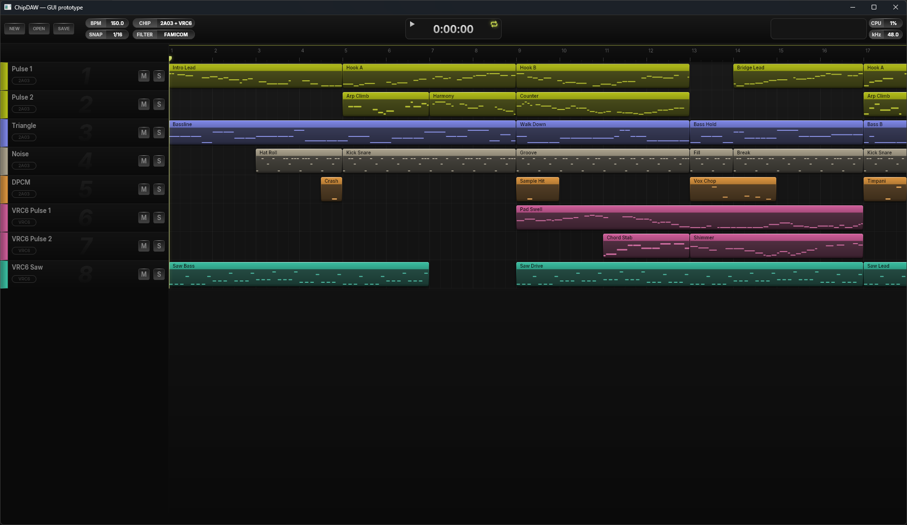
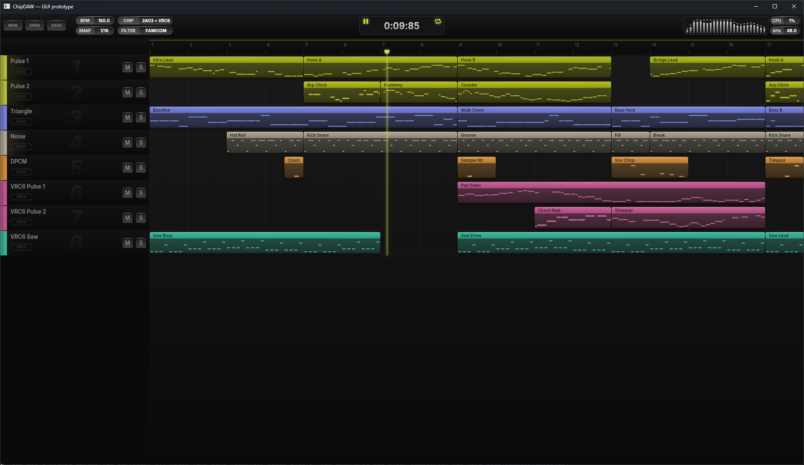
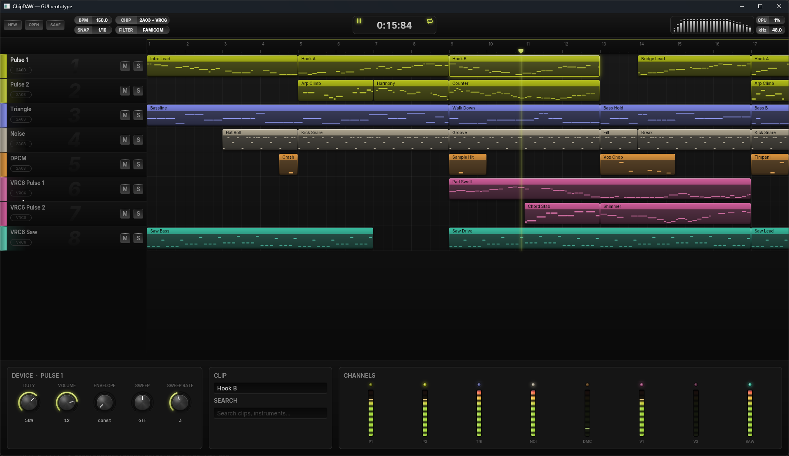
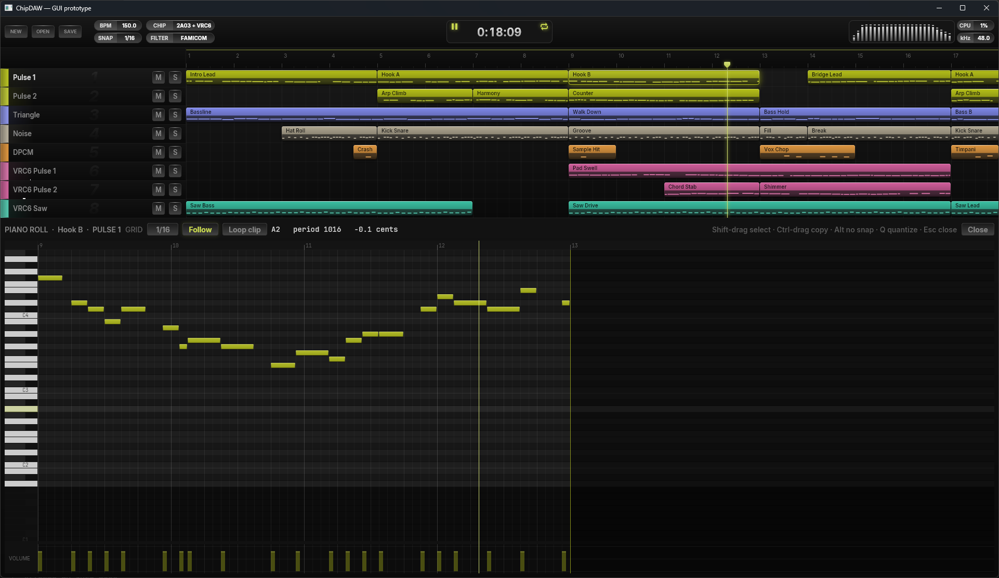

# DESIGN.md: the prototype redesign

Branch `ui/prototype-redesign`. The pre-redesign UI is kept on `backup/pre-prototype-ui`
(same commit as `main`, dd590e8).

The reference is the designer's prototype screenshot, kept at
[`docs/design/reference.png`](docs/design/reference.png) (1920×1080). It shows the
top bar, the track header column (three rows) and an empty arrangement. Everything it
shows was matched as closely as possible. Everything it doesn't show (clips, ruler,
inspector, piano roll) was restyled in the same visual language.

| | |
|---|---|
|  |  |
| Idle, 100% (compare with the reference) | Playing: lime play/playhead, live spectrum, pulsing strips |
|  |  |
| A clip is selected: the inspector opens | Piano roll (double-click a clip) |

Scaled captures: [`main-playing-150.png`](docs/screens/redesign/main-playing-150.png),
[`main-playing-200.png`](docs/screens/redesign/main-playing-200.png). Side by side with the
reference: [`compare-reference.png`](docs/screens/redesign/compare-reference.png) (top: the
prototype; bottom: the app).

## 1. How the reference was read

The prototype is a single PNG, so the values were measured instead of estimated. I cropped
and zoomed regions, then sampled pixel colours along rows and columns through every
element. For example, the M key's column reads `#999` (top edge) → `#161616…#424242`
(body) → `#383838` (bottom stroke), and its top row reads `#3E → #999 → #3A` from corner
to centre to corner. Those numbers are the tokens in `crates/ui/src/theme/tokens.rs`.

Fidelity check, with the reference and the app sampled at the same points (app at
1920×1080, 100%):

| Point | Reference | App |
|---|---|---|
| Capsule fill / stroke | `#151515` / `#323232` | `#151515` / `#323232` |
| Canvas at y=500 / y=1000 | `#131313` / `#0B0B0B` | `#131313` / `#0B0B0B` |
| Track column, column divider | `#0A0A0A`, `#1A1A1A` | `#0A0A0A`, `#1A1A1A` |
| Key top sheen (centre) | `#999999` | `#949494` |
| Key body top → bottom | `#161616 → #424242` | `#1C1C1C → #3F3F3F` |
| Badge stroke | `#323232` | `#323232` |

## 2. Stroke gradients

The prototype's look comes from its 1 px strokes more than from its fills, so every
stroke is drawn procedurally as a ring *inside* its shape (`gfx::ring`, using
`draw_drrect`). That keeps strokes on whole device pixels. Helpers are in
`views/gfx.rs`:

- **`top_sheen`**: the signature effect. A 1 px line along the straight top edge,
  brightest in the middle (`#999`) and fading into the plain stroke (`#383838`)
  towards both corners. It is used on the M/S keys, the file keys, the split pills,
  clips (white, lit by hover/selection) and the snap-guide pill.
- **`ring_hgrad`**: colour strips have a light left edge and a dark right edge
  (sampled: the right edge drops to about half the lane colour), over a fill that
  runs dark→bright from left to right.
- **`ring_vgrad`** and 3-stop rings: clips run from the lane colour lit at the top,
  through a darker band below the header, to a dark bottom edge. Selection brightens
  the whole ring. Piano-roll notes get the same treatment.
- **`hairline(scale)`**: a logical 1 px stroke is `round(scale)` device px. At 150%,
  strokes are a crisp 2 px instead of a blurred 1.5 px. Chrome rects are also
  snapped to device pixels (`gfx::snap`).

CSS can't fade a border along one edge. The few stock buttons left (in the piano-roll
header) use a uniform inset top line, which is the closest a stylesheet gets.

## 3. The 4 px grid

Every layout distance is a multiple of 4: bar heights (top bar 60, ruler band 40, rows
60, compact rows 36), widths (track column 356, capsule and spectrum 204×44, pills 72,
92 and 132×20, keys 24), paddings and gaps (4/8/12/16), radii (4/8), and text baselines
inside rows (20, 48). An audit (grep over the stylesheet and every `Pixels(..)` and
size constant) finds no exceptions apart from 1 px hairlines, font sizes and timing
constants. Where the prototype was off-grid, the grid won:

| Prototype | App | Why |
|---|---|---|
| Top bar 61 px (60 + 1 px line) | 60 including the line | grid |
| Colour strip 18 px wide | 16 | grid |
| Chip badge 53×18 | 52×16 | grid |
| Spectrum: 32 bars, 4 px bar / 2 px gap | 24 bars, 4 px bar / 4 px gap | grid; slightly airier |

## 4. What maps to what

- **Top bar.** Gradient `#191919 → #0A0A0A` under a `#323232` top line.
  - **Centre:** the **transport capsule**. The play light (lime with a glow while
    playing, where it becomes pause) toggles play. The `m:ss:cc` read-out is Inter
    Bold at 88% width (to match the prototype's condensed digits), set in tabular
    cells so digits never shift. Drag it to scrub, double-click it to return to the
    start. The loop light toggles song looping.
  - **Right:** the **spectrum box** shows per-channel engine levels spread into 24
    frequency bands, with attack/release and falling peak-hold dashes. Next to it,
    the **CPU / kHz split pills** show the audio callback's mean load and the real
    output rate.
  - **Left** (empty in the prototype): NEW / OPEN / SAVE keys, and BPM / SNAP /
    CHIP / FILTER pills in the same split-pill style. Drag BPM vertically (Shift for
    fine control), use the wheel, or double-click to reset. Click the others to
    cycle them. Status and crash-recovery messages also appear here.
- **Track rows.** Colour strip with gradient strokes, name, outlined chip badge, a
  ghosted ExtraBold Italic lane number, and M/S keys. Lit keys get a lime glyph and
  glow, like the loop light. New: the strip **brightens and spills light into the
  row on every note-on**. This replaces the old channel-light strip as the demo hook.
- **Canvas.** One gradient (`#191919 → #0A0A0A`) with faint lane and grid lines.
  The area past the loop end is dimmed only while looping.
- **Clips.** Neutral dark bodies tinted with the lane colour, a header in the full
  lane colour, notes in the lane colour, and gradient ring + top sheen. Hover,
  selection and drag states ease as before.
- **Accent.** The prototype's lime `#C7D74E` is used for the play state, playhead,
  loop rail, focus, lit keys and dial arcs.
- **Bottom panel.** None by default, as in the prototype. Selecting a clip opens the
  inspector (dials, clip name, channel meters). Opening a clip shows the piano roll.
  Sections are capsule-style boxes.

## 5. Removed / changed behaviour

- The record-arm button is gone (it never recorded). `AppEvent::ToggleRecord` remains.
- The POS field is replaced by the time read-out. The ruler shows bars, and scrubbing
  works on both.
- The FILE path field is replaced by the NEW / OPEN / SAVE keys (native dialogs).
  Ctrl+N / O / S / Shift+S are unchanged.
- New: the loop light (`AppEvent::ToggleLoop`). With looping off, the engine gets a
  far-away loop end (`NO_LOOP_TICKS`), so playback runs on. A piano-roll clip loop
  always loops.

## 6. Performance

Measured in a release build, with the demo playing at 1920×1080, from the F3 overlay
(`docs/screens/redesign` session): **59.9 fps, worst frame 17.7 ms, about 9% process
CPU, 0.38 ms of custom draw per frame.** The new chrome costs about 0.3 ms of that
(capsule + keys 0.13, track rows 0.08, spectrum 0.07). These numbers are the same as
the pre-redesign PERF.md numbers.

The idle rules from PERF.md still hold:
- views redraw only when their shown text or state changes;
- the CPU/kHz pills refresh at most once a second;
- the spectrum animates only until its bars and peaks have fallen.

`cargo clippy --workspace --all-targets` is clean and `cargo test --workspace` passes.

## 7. Fonts

Added Inter Bold and Inter ExtraBold Italic (Inter 4.1, OFL, the same licence file as
the existing Inter faces).

## 8. Open items

- The window has a minimum size (`ui::MIN_WINDOW_SIZE`, 1140×812 logical), derived
  from the layout constants:
  - the inspector's fixed sections (the dials, and 8 channel meters at 40 px each)
    plus a CLIP section of at least 240 px;
  - 8 full lanes above the inspector.

  Nothing squeezes or slides under the capsule at any allowed size. Messages of
  varying length (save status, audio problems, the recovery prompt) float in a
  notice capsule under the transport, so the top bar only holds fixed-size
  controls.
- The piano roll works like Ableton's detail view. A **split handle** (an 8 px band
  with a grip) sets how much of the arrangement is visible, in 4 px steps, from one
  lane to all eight. The piano roll keeps at least 240 px. Lanes and track headers
  keep their full 60 px height and scroll vertically together when they don't fit:
  - the wheel scrolls them over the lanes or the headers;
  - Shift-wheel scrolls in time;
  - a thin indicator shows the position;
  - opening a clip scrolls its lane into view.

  The split is remembered, and a double-click on the handle restores the default
  (four lanes).
- Already broken before the redesign (the pre-redesign binary crashes too): resizing
  the window from another process with `SetWindowPos` panics in the vizia fork
  (`WinState::resize`, `new_surface_with_dimensions` returns `None`). Dragging the
  window edges, maximizing and restoring work.
- The inspector's dials and meters were recoloured to neutral greys, but their shapes
  are unchanged. The prototype doesn't show them; they could use the key language
  (lit from below, top sheen).
- Key hover is instant. Clips ease (about 150 ms); keys and pills could too.
