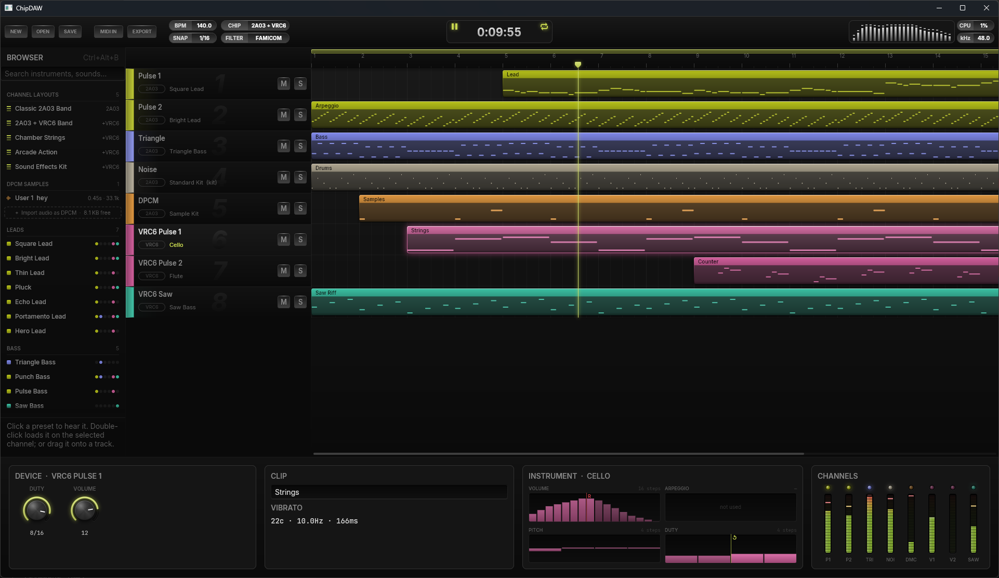
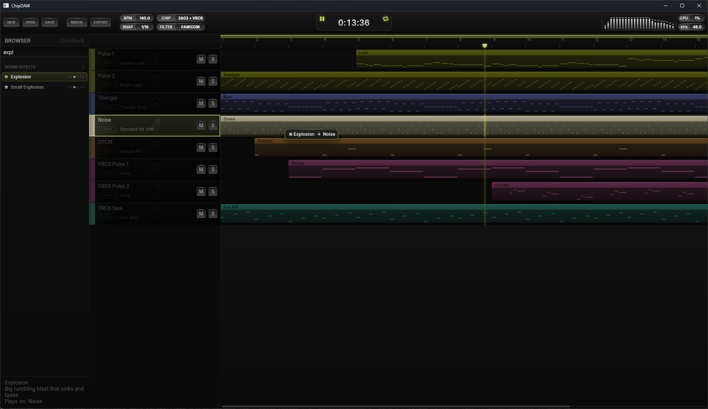
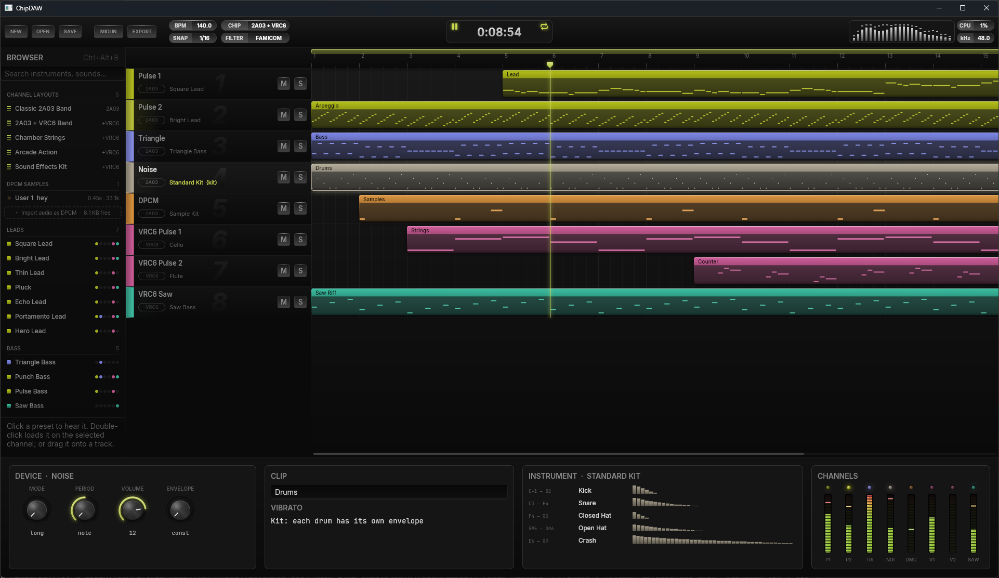
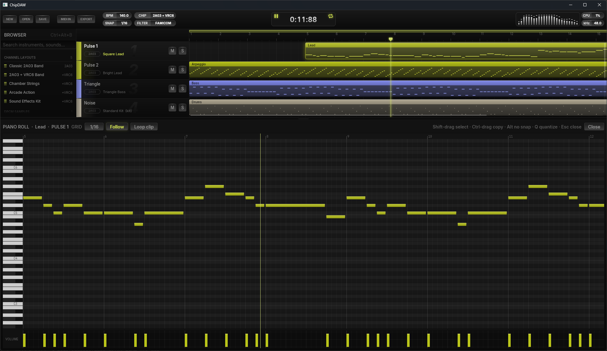

# Cartwave: project rundown

*As of 2026-11-25 · updated for `stabilize/v1.1` (see [STABILIZE.md](STABILIZE.md)) · 2026-11-26: the app is now **Cartwave** by Glintworks (VISION.md); 2026-11-27: renamed in the code too (RENAME.md). "ChipDAW", the working title, stays in the reports written before; it stayed in the code until a planned rename.*

Cartwave is a music workstation for indie game developers. It writes music that plays on
**real sound-chip hardware**: the NES 2A03 and the VRC6 expansion chip,
emulated register by register. It is built in Rust with the Vizia GUI toolkit. Every pixel of
the interface is drawn in code (no images), and it is open source (MIT OR Apache-2.0).



**Listen:** [`docs/screens/product/showcase.wav`](docs/screens/product/showcase.wav) is an
original 16-bar tune on all 8 channels: square leads, triangle bass, a noise drum kit, a sampled
"hey!" on the DPCM channel, and cello and flute on the VRC6. It was rendered by the app's own
engine from [`docs/songs/showcase.mid`](docs/songs/showcase.mid).

---

## 1. What it can do today

| Area | What you get |
|---|---|
| **Arrangement** | 8 chip channels (Pulse 1/2, Triangle, Noise, DPCM, VRC6 Pulse 1/2, VRC6 Saw). Drag, resize and duplicate clips with grid snap; time selection; loop brace; context menus; standard DAW shortcuts; scrollbars; a resizable piano-roll split. |
| **Piano roll** | Note editing with per-note volume, the one-note-at-a-time rule each chip channel has, a quantize command (Q), copy and paste, and named rows for drums and samples. |
| **Instruments** | Instruments are built from per-frame **macros** (volume, arpeggio, pitch, duty) with loop and release points, plus delayed vibrato. This is how real chip drivers make "cello", "flute" or "explosion" on hardware that has no ADSR, LFO or filter. *(v1.1)* A project has an **instrument table**: every lane has a default, and a clip can have its own, so one channel can switch lead → bass mid-song. Instruments are shared by reference; **Make Instrument Unique** gives a clip its own copy. The switch happens at the next note; a held note never changes. |
| **Preset library** *(new)* | 60 factory presets: Leads, Bass, Strings (Cello, Violin, Pizzicato, String Pad), Winds (Flute, Clarinet, Oboe, Ocarina, Pan Pipe), Brass, Keys & Mallets, Arpeggios, Drums, Drum Kits and Sound Effects (Explosion, Laser, Coin, Jump, Power Up, 1-Up, Siren, Thunder, Engine, Wind…). |
| **Channel layouts** *(new)* | 5 one-click bands: Classic 2A03 Band, 2A03 + VRC6 Band, Chamber Strings, Arcade Action and Sound Effects Kit. Each sets the chip and loads one preset per channel. |
| **Browser sidebar** | Ctrl+Alt+B. Search, click to hear, double-click to load, or **drag onto a track**: channels the preset can't play on dim during the drag. *(v1.1)* Drag onto a **clip** to give it that instrument. **User Presets** lists what you saved with "Save Instrument as Preset". |
| **Instrument editor** | The device panel shows the instrument's macros as graphs. Draw on them with the mouse to edit them; undo works. Drum kits show their drum map instead. *(v1.1)* It edits the selected clip's instrument and says how many clips share it. Drag the loop and release markers (Shift-click / Alt-click sets them, a double-click removes one). Vibrato (depth, rate, delay) lives here. Knobs an instrument overrides read "SET BY INSTRUMENT"; the Volume knob is a channel volume that scales everything. |
| **Drum kits** *(new)* | One noise channel plays kick, snare, hats and crash, each with its own envelope; the note's row picks the drum. |
| **DPCM audio import** *(new)* | Drop a WAV file and it is converted to the chip's 1-bit delta format. The highest sample rate that fits the hardware's memory limits is picked automatically. There are 4 user slots next to the built-in drums. |
| **MIDI import** *(new)* | Drop a `.mid` file and it is arranged onto the chip channels. Drums go to the noise kit, the lowest part to the triangle, and chords are reduced to their top note. A track named "DPCM" plays samples. A report says what went where. |
| **Game export** *(v1.1)* | Ctrl+Shift+R opens the export dialog: song, loop region or selection; 44.1/48 kHz, 16/24-bit. **Seamless loops** come as one WAV with `smpl` loop points, as intro + loop files, and as a JSON sidecar. Exporting `intro + loop × 3` is sample-identical to continuous playback. Also **stems** (8 channels, or groups), and loudness (authentic, peak −1 dBFS, or −16 LUFS with a true-peak ceiling). See [docs/EXPORT.md](docs/EXPORT.md). |
| **Files** | `.cartwave` JSON projects (`.chipdaw` before the rename; they open forever) (format v3: instrument table, clip instruments, loop start). v1 and v2 files open and **sound bit-identical** (tested against renders from the build that saved them). Atomic saves, autosave and crash recovery, global undo (1000 steps). Projects, MIDI and WAV files can be dropped on the window or passed on the command line. The three importers survived 10,000 damaged files each without a crash. |
| **Engine** | A clean-room 2A03 + VRC6 emulator, band-limited synthesis, the NES and Famicom output filters, and a lock-free real-time audio thread. |

| | |
|---|---|
|  |  |
| Dragging a preset: only lanes that can play it stay lit | The noise drum kit: each drum's envelope |
|  |  |
| Piano roll (double-click a clip) | Cello on VRC6 Pulse 1: volume swell, release point, duty loop |

---

## 2. How we got here (timeline)

| Date | Phase | Outcome | Report |
|---|---|---|---|
| 2026-11-23 | **GUI bake-off**: can Vizia deliver a premium, image-free DAW UI? | Yes, with conditions (frame pacing and CPU). Every visual target was met: gradients, layered and inset shadows, animated states, custom Skia views. | [FINDINGS.md](FINDINGS.md), [NOTES.md](NOTES.md) |
| 2026-11-23 | **Performance pass** | Playback went from 53–95% of a CPU core to **9–11%**, with 0 missed vblanks and judder-free 60 fps. The fixes are in our Vizia fork (vsync-paced frames, damage tracking). | [PERF.md](PERF.md) |
| 2026-11-23 | **Open-sourced** | Published at github.com/jeffreyfrederick/chipdaw (MIT OR Apache-2.0); now github.com/glintworks-studio/cartwave. | – |
| 2026-11-24 | **Real-time engine**: a clean-room 2A03 + VRC6 emulator, written from hardware docs only | **0 dropouts** over 15 stress runs and 3.5 h of playback. Edits are heard within one console frame (≤ 16.6 ms). Picture-to-sound sync is 0.3 ms. 58 hardware-behaviour tests. | [ENGINE.md](ENGINE.md) |
| 2026-11-24/25 | **Piano roll**, undo, file format, autosave | Songs can be written end to end: 1000-step undo, crash recovery. | [PIANOROLL.md](PIANOROLL.md) |
| 2026-11-25 | **Redesign** to the designer's prototype | Pixel-sampled palette, gradient strokes, 4 px grid, clip-launcher-style editing. | [DESIGN.md](DESIGN.md) |
| 2026-11-25 | **Product pass** | Instruments, presets, layouts, browser, instrument editor, drum kits, DPCM import, MIDI import, WAV export. | this file |
| 2026-11-25 | **Stabilize v1.1** | Asset provenance, re-measurement with instruments on, parser hardening, UX conflicts resolved, per-clip instruments (format v3), game export (seamless loops, stems). | [STABILIZE.md](STABILIZE.md) |

Earlier states are kept as branches: `backup/pre-prototype-ui` (before the redesign) and
`backup/pre-product-pass` (before this pass).

---

## 3. The product pass in detail

### 3.1 Instruments, done the authentic way
The chips have no envelopes, LFOs or filters. Game music drivers got expressive sounds by
rewriting registers 60 times a second, and Cartwave does the same (`crates/chip/src/instrument.rs`):

- **Volume** (0–15 per frame), multiplied with the note's own volume. A **release point** lets a note
  ring out after it ends (a cello's bow lift) instead of cutting off.
- **Arpeggio** (semitones per frame): one channel plays a whole chord, the classic chip trick.
- **Pitch** (accumulating, 1/16 semitone per frame): scoops, falls, lasers and sirens.
- **Duty** (pulse width per frame): timbre that changes as the note plays (brass brightening, string bowing).
- **Vibrato** with delay and fade-in.

The driver only writes a register when its value changes. In particular it avoids rewriting the
pulse's high period byte, which would click the phase. That keeps pitch effects clean, the way
careful drivers did it on hardware. Each preset also declares which channel types it suits.
Every preset is rendered on every channel it fits in an automated test, so none can ship silent
or broken.

### 3.2 Why "audio import" means DPCM, and why there are no FX
The DPCM channel is the only place a real NES plays recorded sound: 1-bit delta samples, at most
4081 bytes each, from a 16 KB sample ROM. Importing a WAV converts it into exactly that, so what
you hear is what the hardware would play. Free-form audio tracks and reverb would break the
"accurate chip" promise, so they are deliberately left out. Authentic "effects" (echo, vibrato,
arpeggio, slides) are instrument macros instead. The **Echo Lead** preset fakes an echo with
quieter repeats, as drivers did.

### 3.3 New files
| File | What |
|---|---|
| `crates/chip/src/instrument.rs` | Macro sequences, release and loop semantics, kits (no_std, no allocation) |
| `crates/chip/src/presets.rs` | The 60 presets and 5 layouts, with tests |
| `crates/ui/src/instruments.rs` | Per-lane instruments in the UI model; flattening into the engine's bank |
| `crates/ui/src/views/browser.rs` | The browser sidebar, drag ghost and drop targets |
| `crates/ui/src/views/instrument.rs` | The macro-graph editor and kit view |
| `crates/ui/src/dpcm.rs` | WAV reader, DPCM conversion, sample ROM layout |
| `crates/ui/src/midi.rs` | Standard MIDI File parser and the arranger |
| `crates/ui/src/export.rs` | Offline WAV render |
| `crates/ui/examples/render.rs` | Command-line render: `cargo run --release -p ui --example render -- tune.mid out.wav` |

---

## 4. Quick start

```
cargo run --release -p app                     # the app (opens the demo song)
cargo run --release -p app -- song.mid hey.wav # open a MIDI file and import a sample
```

| Action | How |
|---|---|
| Play / stop | Space |
| Browser | Ctrl+Alt+B · click = hear · double-click = load · drag onto a track |
| Whole band | Click a **Channel Layout** in the browser |
| Edit an instrument | Select a clip, then draw on the macro graphs in the device panel |
| Piano roll | Double-click a clip (Esc closes) |
| Import MIDI / audio | Drop the file on the window, or **MIDI IN** (Ctrl+I) / the browser's "Import audio" row |
| Export WAV | **EXPORT** (Ctrl+Shift+R) |
| Save / open / new | Ctrl+S / Ctrl+O / Ctrl+N · Undo Ctrl+Z, redo Ctrl+Shift+Z |

---

## 5. Architecture

```
crates/chip    no_std emulator: APU channels, VRC6, mixer, band-limited synth,
               frame-tick sound driver, instruments, presets      (no allocation)
crates/engine  real-time audio thread (cpal), lock-free command queue, immutable
               song snapshots; the UI can never block the audio
crates/ui      the interface (library, so it can also be hosted as a plugin)
crates/app     the standalone window (a few lines)
```

The UI and audio threads share nothing mutable. Every edit, including instrument and sample
changes, becomes an immutable snapshot that the engine swaps in at the next frame tick, and old
snapshots are freed on the UI thread.

## 6. Quality status
- **153 automated tests** pass (chip 71, engine 10, UI 72, including the parser robustness
  campaigns, migration identity and loop-export identity). `cargo clippy` is clean.
- Re-measured in v1.1 with instruments on (STABILIZE.md §A2): 0 audio dropouts in every stress run.
  The worst-case macros cost 0.35% of the audio period. The UI meets PERF.md's targets: demo playback
  sits at the 10% line, and piano-roll dragging went from 33% to 8%.
- The showcase song's 29 s render peaks at −5.1 dBFS with no clipping.

## 7. Known gaps and next steps
1. The macOS pass: the engine and piano roll still need their Mac measurements, and v1.1 hasn't run on the Mac.
2. Default-device switching (stress test E) needs the MOTU reconnected (STABILIZE.md, known gaps).
3. Per-note instrument changes (`NoteFx`); macro sequence length can't be changed by dragging (new macros start at 16 steps).
4. MIDI import reduces chords to the top note. Splitting chords across free channels would be better.
5. Live looping re-quantises notes to the frame clock on every pass; the exported loop keeps the second pass (docs/EXPORT.md §7).
6. VRC6 vs 2A03 relative level needs one hardware recording to calibrate (ENGINE.md §6.5).
7. Shipping: installer and code signing, a final name and branding, 120/144 Hz displays, and AMD/Intel GPU checks.
