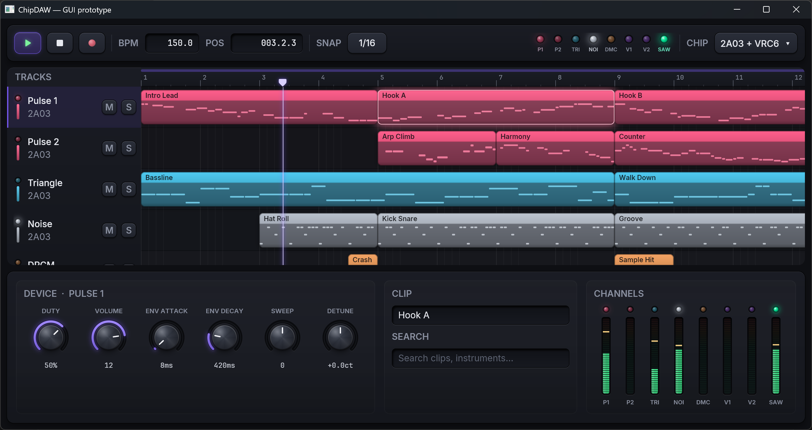

# ChipDAW: Vizia GUI prototype

> **Prototype.** "ChipDAW" is a working title. This repository started as a GUI bake-off: it
> tests whether [Vizia](https://github.com/vizia/vizia) can deliver a fully custom,
> premium-looking DAW interface drawn entirely with stylesheets and procedural drawing (no
> bitmap images). It now plays the arrangement in real time through a clean-room NES 2A03 +
> VRC6 emulator (`crates/chip`, `crates/engine`; see [ENGINE.md](ENGINE.md)). The clips and
> notes are still demo data.



The target product is a chiptune workstation for indie game developers (2A03 + VRC6 channel
layout, arrangement view). This prototype covers only the UI: arrangement clips with layered
lighting, rotary dials, inset text fields, level meters and a channel visualizer.

## Build and run

Requires a recent stable Rust toolchain (built with rustc 1.100).

```sh
cargo run --release -p app
cargo run --release -p app -- --size 1200x800   # initial logical window size
```

Vizia is pulled from a fork, pinned by commit in `[patch.crates-io]` in `Cargo.toml`:
[jeffreyfrederick/vizia @ `chipdaw-perf`](https://github.com/jeffreyfrederick/vizia/tree/chipdaw-perf)
(tag 0.4.0 plus six focused performance fixes, described in [PERF.md](PERF.md) §8). The first
build compiles Skia through `skia-safe`, which downloads prebuilt binaries when they are
available for your target.

Layout:

- `crates/chip`: the emulator and sound driver (`no_std`, no dependencies).
- `crates/engine`: the real-time host (cpal output, lock-free queues, song snapshots).
- `crates/ui`: the library (views, theme, state; reusable in a plugin host).
- `crates/app`: the standalone window. `--render-demo DIR` renders the demo offline to WAV.

## Controls

| Where | Input | Action |
|---|---|---|
| Global | `Space` | Play / stop |
| | `F3` | Frame-time overlay |
| | `F4` | Toggle the 200-clip stress set |
| | `F5` | Reload stylesheets |
| | `F6` | Cycle the frame-rate cap: 60 (default) / 120 / off (shown in F3) |
| | `F7` | Cycle the analog output filter: NES / NES + 440 Hz / Famicom / off (shown in F3). Until you press it, the filter follows the chip: Famicom with VRC6, NES with the 2A03 alone |
| Track headers | `M` / `S` | Mute / solo the channel |
| Arrangement | Click / `Shift`-click | Select / add to selection |
| | Drag clip body | Move (time and lane), snapped to the grid |
| | Drag clip edge | Resize |
| | `Alt` while dragging (macOS: `Cmd`) | Disable snap |
| | `Ctrl`-drag (macOS: `Option`-drag) | Duplicate |
| | `Delete` / `Backspace` | Delete selection |
| | `Ctrl`+`A` (macOS: `Cmd`+`A`), `Esc` | Select all, clear selection |
| | Wheel / two-finger swipe | Scroll horizontally |
| | `Ctrl`/`Cmd`+wheel | Zoom around the cursor |
| Ruler | Click / drag | Move the playhead (`Alt`, macOS `Cmd`: no snap) |
| Dials | Vertical drag, wheel | Change value (`Shift`: fine) |
| | Double-click | Reset to default |
| BPM / Pos fields | Drag, wheel | Scrub value (`Shift`: fine, BPM) |
| | Double-click | Reset (150 BPM / start) |

Set `CHIPDAW_FRAMELOG=<path>` to write a per-frame CSV log (frame timings by phase), and
`CHIPDAW_FPS_CAP=60|120|off` to choose the starting frame-rate cap (default `60`; `display` is an
alias for `off`; see [PERF-macos.md](PERF-macos.md) §6). On macOS the modifier mappings follow Mac conventions; they are
defined in `crates/ui/src/input.rs`.

## Documents

- [NOTES.md](NOTES.md): Vizia capability checklist (what the stylesheet system supports, and the fallbacks).
- [FINDINGS.md](FINDINGS.md): bake-off report and verdict.
- [PERF.md](PERF.md): playback CPU and frame-pacing investigation and fixes (Windows).
- [PERF-macos.md](PERF-macos.md): the same on macOS (Apple M1, 320 Hz), and the frame-rate cap.
- [ENGINE.md](ENGINE.md): the chip engine. Emulation, band-limiting, the real-time architecture,
  stress tests, authenticity checks and known gaps. The listening pack is in
  [`docs/audio/`](docs/audio/), and the tuning table is in [`docs/tuning.md`](docs/tuning.md).
- [CLAUDE.md](CLAUDE.md): the original prototype brief.

Screenshots and a demo recording are in [`docs/screens/`](docs/screens/). Profiles,
flamegraphs and the measurement harness are in [`docs/perf/`](docs/perf/).

## License

Licensed under either of [Apache License, Version 2.0](LICENSE-APACHE) or
[MIT license](LICENSE-MIT), at your option.

Unless you explicitly state otherwise, any contribution intentionally submitted for inclusion
in this work by you, as defined in the Apache-2.0 license, shall be dual licensed as above,
without any additional terms or conditions.

Third-party components keep their own licenses. The bundled fonts (Inter and JetBrains Mono)
are under the SIL Open Font License 1.1; see `assets/fonts/*-OFL.txt`. Some dependencies
(including Vizia's CSS stack) are MPL-2.0, which is file-level copyleft and compatible with
this license choice.
