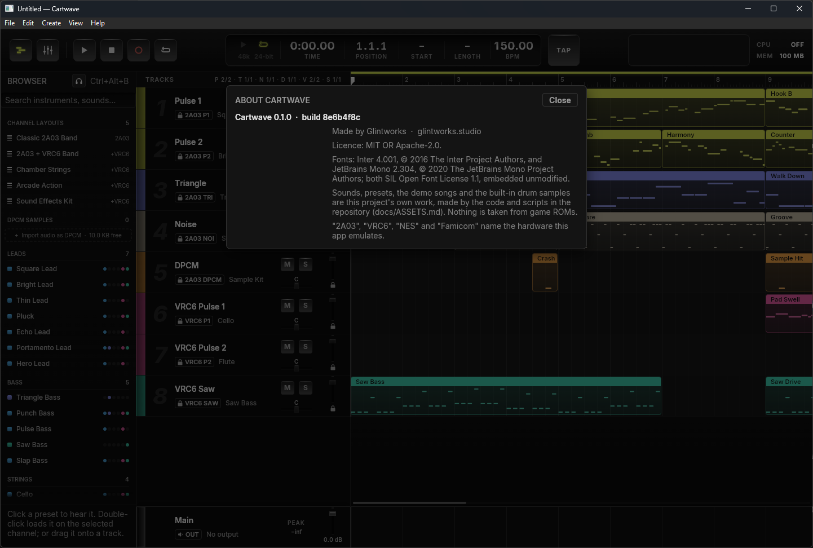

# RENAME.md: ChipDAW → Cartwave, by Glintworks

*2026-11-27 · RENAME_PROMPT.md · branch `rename/cartwave` from `main` 8e6b4f8 · Windows PC ·
decisions in [docs/RUNLOG.md](docs/RUNLOG.md) (RN-D1…)*

**Cartwave** is the app, **Glintworks** ([glintworks.studio](https://glintworks.studio)) the
company. This was a rename only: no behaviour changes, every audio hash the same, and the only
pixels that differ are text showing the name.

## 1. Summary

**Merge: done.** Every gate passed: `pre-rename` tags the old `main` (8e6b4f8), `main` was fast-forwarded to `rename/cartwave` and pushed to `glintworks-studio/cartwave` (§7).****

| # | Gate | Result |
|---|---|---|
| 1 | Golden and every migration hash unchanged (audio data) | **PASS**: `cargo test` (golden, v2…v7 migration hashes) unchanged and passing; all **290** `.chipdaw` files in the repo render and export to the **same hashes** in the baseline and this branch ([table](docs/rename/corpus-hashes.tsv)); exports: **every WAV byte-identical** in 101 files, each loop JSON differs only in its `format` field ([report](docs/rename/export-identity.md)) |
| 2 | `.chipdaw` files from every corpus version open and render identically | **PASS**: v1 (the scale test), v2…v7 corpus, the stress projects and every suite fixture: 290 files, 0 load errors, identical hashes; new test `every_corpus_file_round_trips_through_a_cartwave_file` (every version → `.cartwave` → same text, same sound) |
| 3 | The settings migration test | **PASS**: unit tests (`app_data_folder_moves_and_old_one_is_kept_until_next_launch`, `recovery_takes_a_legacy_file_in_its_folder`) and the real app, end to end, under a redirected `%APPDATA%` (`docs/rename/tools/migrate_e2e.ps1`): launch 1 copies `ChipDAW` → `Cartwave` (settings, presets, a subfolder, `recovery.chipdaw` → `recovery.cartwave`), keeps the old folder and offers the crashed session's recovery; launch 2 removes the old folder and the marker; the settings (autosave 5 min, a recent file) are kept; launch 3 moves nothing ([obs.json](docs/rename/migrate/obs.json), [screenshot](docs/screens/rename/migrated-recovery-offer.png)) |
| 4 | Visual regression: only text showing the name differs | **PASS** at 100 % and 150 % ([100](docs/rename/regression/report-100.md), [150](docs/rename/regression/report-150.md)); every differing region is listed below (§4) |
| 5 | All suites with the new names, and one run with the old names | **PASS**, both runs, on the final build: AT-01…31 (shell 9 tests, Batch 3 17), DP-01…05, PL-01…05, P2-01…11, B4A-01…09, **B4B 43/43**, with `CARTWAVE_*` ([summary](docs/rename/suites-new-names.txt)) and again with every harness script spelled `CHIPDAW_*` ([summary](docs/rename/suites-old-names.txt)); the alias run's app logs show the dev-mode alias notes (65 launches) |
| 6 | `cargo test` debug and release; clippy; warnings | **PASS**: **268 passed, 0 failed, 2 ignored** in debug and in release (261 before + 7 new) ([debug](docs/rename/test-run-debug.txt), [release](docs/rename/test-run-release.txt)); `cargo clippy --workspace --all-targets` clean; release build of every target 0 warnings |
| 7 | No user-facing "ChipDAW" / "chipdaw" left in the app | **PASS**: no user-facing old name in the source or the release binary's strings; the allowed exceptions are listed in §4 |

## 2. What was renamed

- **The executable:** `cartwave` (`target/release/cartwave.exe`). The package stays `app`, so
  `cargo run --release -p app` still builds and runs it (RN-D2). Manifests: `authors =
  ["Glintworks"]`, homepage glintworks.studio.
- **What the app shows:** the window title (`Untitled — Cartwave`), About (`ABOUT CARTWAVE`,
  `Cartwave 0.1.0 · build …`, and a new line **Made by Glintworks · glintworks.studio**), the Help
  menu's *About Cartwave*, the macOS app menu (*Cartwave*, *Hide Cartwave*, *Quit Cartwave*;
  the shortcut sheet's Quit row on macOS), the warning dialogs' title, the file dialogs' type
  names, the drop hint, and the file errors ("Not a Cartwave project", "saved by a newer
  Cartwave").
- **Environment variables:** every `CHIPDAW_*` is now `CARTWAVE_*`. **The old names stay
  accepted as aliases** (one reader, `engine::env`; the new name wins when both are set); in dev
  mode an alias prints `dev: CHIPDAW_X is the old name of CARTWAVE_X; it still works, but use
  CARTWAVE_X`, once per name (RN-D3). Every harness and tool uses the new names (81 scripts,
  RN-D11).
- **Project files:** new projects save as **`.cartwave`**. **`.chipdaw` opens forever** (Open,
  drop, Open Recent, the dev hook). Save keeps an existing file's extension; **Save As offers
  `.cartwave`** and lists `.chipdaw` too; Open lists both. The format version is unchanged (8)
  (RN-D4).
- **Settings, presets and recovery:** `%APPDATA%\Cartwave` (macOS `~/Library/Application
  Support/Cartwave`, Linux `~/.local/share/cartwave`). On the first launch the old `ChipDAW`
  folder is **copied** over when the new one doesn't exist; the old folder stays as the backup
  until the next launch has come up, then it is removed. The recovery file is
  `recovery.cartwave`; an old `recovery.chipdaw` takes the new name, so an unsaved session from
  before the rename is still offered (RN-D5, RN-D6).
- **Export metadata:** the loop JSON's `"format"` is `"cartwave-loop"` (the only place an
  export names the software; WAVs carry no software chunk, so they are unchanged) (RN-D7).
- **Identifiers:** `studio.glintworks.cartwave` is the Windows AppUserModelID (set at start) and
  the Mac bundle id for later (`[package.metadata.bundle]`); one place for the names:
  `crates/ui/src/identity.rs` (RN-D8).
- **Docs:** README (the Glintworks line and link), CLAUDE.md, VISION.md (the rename note says
  *done*; the trademark item cleared), PRODUCT.md, UX.md, SHELL.md, PIANOROLL.md (the format
  section), ENGINE.md, docs/EXPORT.md and the tool READMEs use the new names. Historical reports
  keep their text with a one-line note at the top: PERF.md, PERF-macos.md, ENGINE-macos.md,
  STABILIZE.md, MAC-CATCHUP.md, BATCH3/4A/4B.md, POLISH.md, POLISH2.md, DESIGNPASS.md,
  DOCS-2026-11-26.md, FINDINGS.md, PERF_PROMPT.md, MAC_PROMPT.md, the UX audit, docs/upstream
  and a few result pages.
- **The GitHub remote:** `origin` is `https://github.com/glintworks-studio/cartwave.git` (RN-D1).

## 3. What deliberately wasn't

| Kept | Why |
|---|---|
| The vizia fork's `chipdaw-perf` branch and the nine pins | Internal; renaming it risks the pins (the prompt) |
| The file's `"format": "chipdaw"` field | It names the file format, not the app; every file ever written has it; changing it needs a format bump for no user benefit (RN-D4) |
| `CHIPDAW_*` as accepted aliases | Old scripts and shells keep working (the prompt) |
| The corpus and fixture `.chipdaw` files | They are the old files the tests open |
| Git history, RUNLOG entries before RN, the historical reports' text | The prompt; each report has a note at the top |
| The package name `app` | It contains no old name; every harness builds `-p app` |
| Temp-folder names inside the tools, `make_songs`' `piano_bench.chipdaw` | Internal; the perf tools copy previously generated files by these names (RN-D10) |
| `docs/export-examples/showcase.json` beyond its `format` line | The example predates Batch 4a; regenerating it would change more than the name (RN-D7) |
| A Windows VERSIONINFO resource (company, product in Explorer's file properties) | Needs a resource-compiler crate; CLAUDE.md says ask first. Proposed, not added |

## 4. The gates in detail

### Visual regression (gate 4)
`docs/rename/tools/regress_rn.ps1` (polish 2's states plus About, the shortcut sheet, Settings ▸
Files and the Help menu; frozen levels, 1440×920 logical) on the baseline (main 8e6b4f8, run
with `CHIPDAW_*`) and this branch (`CARTWAVE_*`); `diff_rn.py` compares **the whole window**
(title bar included), allows nothing up front, and lists every region that differs. Every
differing region, at both scales:

| Region | States | What it is |
|---|---|---|
| Title bar text | all 15 | `Untitled — ChipDAW` → `Untitled — Cartwave` |
| Help menu, last item | `menu_help` | *About ChipDAW* → *About Cartwave* |
| The About panel | `about` | its title, the name line, and the new *Made by Glintworks · glintworks.studio* line (the credits below it move down one line) |
| A few pixels in the window's corners | some | outside the window's rounded frame: the desktop behind it (they differ between states of one build too) |



With the **old names** (`CHIPDAW_*`) this build's 15 shots are pixel-identical to its run with the
new names ([report](docs/rename/regression/report-100-old-names.md)), and each alias prints its
dev-mode note. Harness notes: at 150 % the window is taller than the work area, so the script
now pins its frame to the screen's top-left (Windows had placed it at a different height in each
run); one `solo_mute` shot lost its second click (the known quick-click flake) and matched when
re-shot (RN-D14).

### Suites (gate 5)
`docs/rename/tools/run_suites_rn.ps1` runs every scenario suite on the final release build: the
earlier suites (shell AT-01…19, Batch 3 AT-07…31, design DP-01…05, polish PL-01…05; Overview and
status bar hidden, as polish 2 runs them), then P2-01…11, B4A-01…09 and B4B (43 checks).

| Run | Result |
|---|---|
| New names (`CARTWAVE_*`) | every suite passes: 49 + 79 + 23 + 14 + 92 + 53 PASS lines, B4B 43/43, 0 FAIL |
| Old names (`CHIPDAW_*`; every harness script under `docs/` spelled with the old names in place, restored from git after) | the same: every suite passes, B4B 43/43, 0 FAIL; each app log has its `dev: CHIPDAW_X is the old name of CARTWAVE_X …` lines |

Harness changes needed by the rename (name text only): the shell suite looked for
`recovery.chipdaw` and `ABOUT CHIPDAW`; the screenshot helper `shot.ps1` found the window by a
title containing "ChipDAW" (it now takes either name, so pre-rename builds still work). A first
old-names attempt rewrote only the suite scripts, not the shared helpers they dot-source (which
still set `CARTWAVE_*`, and the new name wins): B4B-C1 opened the previous scenario's project.
The runner now rewrites the whole harness; that run is the one reported (RN-D15).

### Binary strings (gate 7)
`git grep -i chipdaw crates/` and a scan of `target/release/cartwave.exe` (ASCII and UTF-16
strings). What remains, all allowed:

| String | Why |
|---|---|
| `CHIPDAW_` | the alias prefix (`engine::env`) |
| `ChipDAW`, `chipdaw` (data folder) | the pre-rename folder the first launch moves |
| `chipdaw` (extension) | `.chipdaw` opens forever; the Save dialog's second filter, *Cartwave project, old extension*, shows it |
| `chipdaw` (format) | the file's `format` field (RN-D4) |
| `migrated-from-chipdaw.txt` | the move's marker, present until the next launch |
| `…\pixelwide_studio\chipdaw\target\…` | this PC's checkout folder, embedded by the GL binding crates' build scripts in panic messages; a build from a folder with another name doesn't have it |
| Tests (`file.rs`, `env.rs`, `tests/`) | they open the old files and names on purpose |

The vizia fork's `chipdaw-perf` branch (in `Cargo.toml` comments and the pins' history) and the
historical reports are the other listed exceptions.

## 5. GitHub: the CEO's steps

The CEO had already done them before this run: `git ls-remote` on
`https://github.com/glintworks-studio/cartwave` answered, so this checkout's `origin` now points
there and `main` matched (RN-D1). For any other clone:

1. (Done) Transfer `jeffreyfrederick/chipdaw` into the `glintworks-studio` organisation
   (Settings ▸ General ▸ Danger Zone ▸ Transfer).
2. (Done) Rename it `cartwave` (Settings ▸ General ▸ Repository name).
3. In each existing clone, the one command:

   ```sh
   git remote set-url origin https://github.com/glintworks-studio/cartwave.git
   ```

   (GitHub redirects the old URL after a transfer, so a clone that skips this still works.)

The vizia fork stays at `jeffreyfrederick/vizia` (branch `chipdaw-perf`); moving it into the
organisation would mean updating the nine pins and is not part of this rename.

## 6. For the owner

- **Your real settings folder moves on your first launch of Cartwave:** `%APPDATA%\ChipDAW`
  (settings, a recovery file) is copied to `%APPDATA%\Cartwave`; the old folder is removed on the
  launch after. This run never touched it (its tests used a redirected folder).
- Scripts that set `CHIPDAW_*` keep working; switch them to `CARTWAVE_*` when convenient.
- Old builds of the pre-rename app read only `CHIPDAW_*` and `%APPDATA%\ChipDAW`: to compare
  against one, run it with the old names (`regress_rn.ps1 -Prefix CHIPDAW_`).

## 7. Merge result

Every gate passed, so per the prompt (§2.3):

- `rename/cartwave` pushed to `glintworks-studio/cartwave`;
- `git tag pre-rename main` (8e6b4f8) and the tag pushed;
- `main` fast-forwarded to `rename/cartwave` and pushed.

No force-push, no history rewrite, no deleted branches, no pull requests or issues. Baseline
worktree for comparisons: `../before-rename` (8e6b4f8, release built; its `app.exe` copied to
`cartwave.exe` for the shared helpers).
