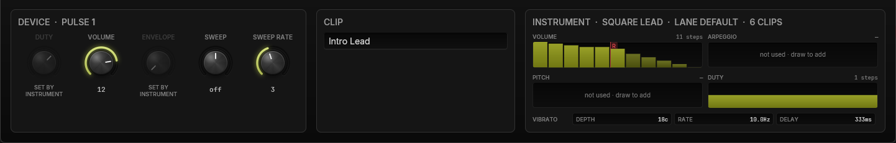
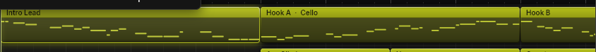
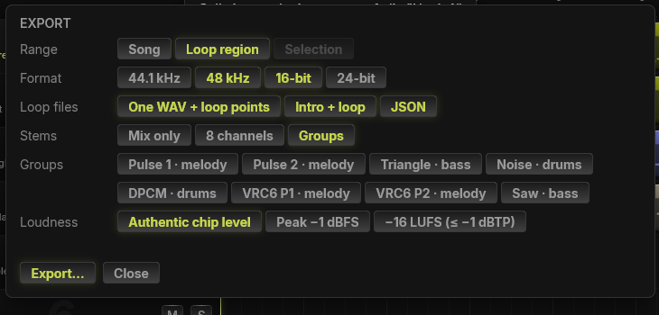

# STABILIZE: v1.1 (stabilize, per-clip instruments, game export)

> *Historical report, kept as written under the working title ChipDAW. Since the rename (2026-11-27, [RENAME.md](RENAME.md)) the app is Cartwave by Glintworks: projects save as `.cartwave`, the executable is `cartwave`, and environment variables are `CARTWAVE_*` (the `CHIPDAW_*` names still work).*

*Unattended run, 2026-11-25, 07:44–10:26 · branch `stabilize/v1.1` (from `product/v1`) · Windows 11,
Ryzen 7 9800X3D, RTX 4070 SUPER, 59.951 Hz display · the brief: STABILIZE_PROMPT.md · every decision,
with its time: [docs/RUNLOG.md](docs/RUNLOG.md).*

## Summary

| Gate (§4) | Result |
|---|---|
| 1. Tests and clippy | **PASS**: 153 tests (chip 71, engine 10, UI 72), clippy clean, release build 0 warnings |
| 2. Stress matrix A, B, C, G: 0 loopback dropouts | **PASS**: 0 in all 16 runs on the pre-B build (A, B, C, G × 3 sizes + D + H), and **0 in A, B, C, G and H on the final build** |
| 3. PERF.md targets in every UI scenario | **PASS, one at the line**: demo playback ~10.2% vs ≤ 10% (same as before this pass in an A/B, within PERF.md's noise). A real regression in piano-roll dragging (33%) was found and **fixed** (8%) |
| 4. Loop-export identity (C1) | **PASS**: `intro + loop × 3` = continuous render, sample for sample, at 44.1/48 kHz × 16/24 bit, showcase and test song |
| 5. v1/v2 → v3 migration bit-identical | **PASS**: the v1 golden song and 9 v2 files saved by the old build, both render paths, hashes from the old build |
| 6. ASSETS.md complete | **PASS**: every non-code file, including two generated assets proved by byte-identical regeneration |
| 7. No parser panics | **PASS**: 10,000 inputs per parser (release and debug), 0 panics or hangs, after fixing 6 crash bugs |

**Merged into `main`: not yet. Every gate passes and the merge is ready** (a fast-forward; decision D18 in RUNLOG covers gate 3's demo figure), but this session's automatic permission check blocked merging and pushing `main`. To merge: `git checkout main && git merge --ff-only stabilize/v1.1 && git push origin main`.

**Fixed:**
- 6 parser crash bugs (overflows, a byte-slice panic, a terabyte allocation, NaN samples) and 3 data
  bugs (dropped MIDI notes, silent out-of-range notes, unchecked sample ROM size).
- Piano-roll drag CPU: 33% → 8%.
- A held note could change instrument when the bank was reordered.
- The benchmark scripts had dragged nothing since the redesign.
- Six UI bugs found by the scenarios.

**Decisions taken without you** (D1–D17 in RUNLOG):
- the MOTU was disconnected, so audio tests ran on the HDMI output and test E was skipped;
- the dropout pilot moved to 23 kHz (19 kHz gives false dropouts under the Famicom filter);
- the file format went to v3 already in Part A;
- the inspector's meters were removed in favour of the top spectrum;
- text tokens raised for contrast;
- out-of-range MIDI notes are folded into range by octaves;
- seamless loops latch the emulator state at the second pass, so `intro.wav` holds the intro plus
  the first pass;
- a preset dropped on a clip sets only its instrument;
- drawing on an unused macro starts one;
- `CLAUDE.md` is left untouched.

---

## A. Stabilize

### A1. Asset provenance ([docs/ASSETS.md](docs/ASSETS.md))
- **"hey!" sample and `showcase.mid`: provably ours.** The product-pass session generated both
  with a Python script (formant-ish harmonics plus a noise burst for "hey"; an original Am–F–C–G
  tune). The script was never committed. It was recovered from that session's scratch folder,
  committed as `tools/assets/make_assets.py`, and **reproduces both files byte for byte**. The
  committed `showcase.wav` re-renders byte-identically too. Nothing was replaced, and no history
  was touched.
- **Fonts:** Inter 4.001 and JetBrains Mono 2.304 (read from their `name` tables), with the OFL files
  present. The DPCM drums are synthesised in code. The demo and stress songs are seeded procedural
  data. The screenshots and listening-pack audio come from this app.
- **Names:** "Ableton" was removed from code comments, DESIGN.md ("clip-launcher-style editing")
  and PRODUCT.md. `CLAUDE.md` (your brief) still names "Konami VRC6" and "Ableton-style"
  descriptively; rewording it is your call. Old commit messages also say "Ableton"; history is
  not rewritten. "NES", "Famicom", "2A03" and "VRC6" are kept: they name the emulated hardware.

### A2. Re-measurement with the new features on

Audio ran on the monitor's HDMI output (480-frame callbacks); **the MOTU was disconnected** (PnP
status "Unknown"). The engine already played the "2A03 + VRC6 Band" layout. The worst case is a new
`CHIPDAW_SONG=heavy`: every lane loops all four macros plus vibrato, on 2-beat notes.

**Dropout ground truth.** A 20 s run of the heavy song first reported 58 loopback dropouts with 0
starved/late callbacks. Third source: re-run with the pilot at 23 kHz, above the synthesis
passband, gave 0. Validation: injected 30 ms / 15 ms audio stalls were caught 5/5 and 0/5
respectively, matching ENGINE.md's ≥ 22 ms threshold. The 19 kHz pilot is masked by music under the
Famicom filter, which became the VRC6 default after ENGINE.md's matrix. The default pilot is now
23 kHz.

| Stress test (600 s / 120 s) | ENGINE.md | v1.1 pre-B build (3 buffer sizes) | v1.1 final build |
|---|---|---|---|
| A. Demo playing | 0 dropouts; cost 0.22 / 0.6 / 3.5% | **0**; 0.21 / 0.6 / 3.5–3.8% | **0**; 0.22 / 0.6 / 3.3% |
| B. 200 clips + edits every tick | 0; 0.08 / 0.3 / 3.1% | **0**; 0.08 / 0.3 / 1.3–3.1%; 141k edits, edit → tick ≤ 16.64 ms | **0**; 0.08 / 0.3 / 3.3%; 141k edits |
| C. 250 ms UI stall every 2 s | 0; 0.22 / 0.6 / 3.5% | **0**; 0.21 / 0.6 / 0.9–3.3%; 60 stalls each | **0**; 0.21 / 0.6 / 0.7%; 60 stalls |
| G. A/V sync | 0; −10.97 ms, sd 0.10 | **0**; −10.29 … −10.33 ms, sd 0.10 (HDMI: 10 ms period) | **0**; −10.34 ms, sd 0.11 |
| D. Resize churn | 0; sd 0.23–0.45 | **0**; sd 0.43–0.58 ms; no crash on external resizes | — |
| H. Heavy macros (new) | — | **0**; 0.35 / 1.3 / 3.7% | **0**; 0.35 / 1.4 / 3.1% |
| E. Default-device switch | gap ~0.4 s | **skipped**: only one output device present | — |

Costs are callback mean / p99 / max as % of the period. Every run: 0 allocations on the audio
thread, 0 dropped commands. **The audio cost of the worst-case macros: mean 0.35% of the period
(demo 0.21%), p99 1.3%.**

| UI (CPU % of one core, 3 runs; pacing 30 s) | PERF.md / PIANOROLL.md | v1.1 |
|---|---|---|
| Idle | 0.0–0.7% | 0.3 / 0.4 / 0.7% |
| Demo playing (≤ 10%) | 8.8–10.3% | 10.5 / 10.5 / 10.4%, A/B 9.5 / 10.1% (old build in A/B: 10.8 / 9.1%); pacing 0 > 20 ms, 0 missed |
| 200 clips playing (≤ 20%) | 9.2–10.8% | 9.1 / 11.6 / 11.2%; pacing 0 > 20 ms, 0 missed |
| 200-clip drag (≤ 25%) | 10.2–12.1% | 12.0 / 12.8 / 12.5%; pacing 0 > 20 ms in 2 of 3 runs (one 33 ms frame in one) |
| Piano roll open, playing (≤ 20%) | 6.4–6.8% | 5.9 / 6.6 / 6.5%; pacing 0 > 20 ms |
| Piano roll, dragging notes (≤ 25%) | 12.5–16.0% | **before the fix: 32–35%, 5 frames > 20 ms**; after: **7.3 / 8.1 / 7.8%**, pacing 0 > 20 ms ×2 |

- **The harness had gone stale.** Since the redesign, the "drag" scenarios pressed on a track header
  (arrangement) and on an empty row (piano roll), so they measured no drag at all. They now drag a
  real clip and the C4 handle note; mid-drag screenshots confirm both. With real drags the piano
  roll showed **33% CPU**. An A/B against the untouched `product/v1` build (with a v2 bench file,
  because the old build correctly refuses v3) showed the same 33%. So it dates from the redesign:
  each note became two gradient shaders and two rounded rects, and the 2,000-note layer was redrawn
  on every pointer move.
  **Fix** (PIANOROLL.md §8's proposed next step): the layer stays cached, keyed on the notes that
  aren't dragged, and the dragged ones are drawn live → **8%**.
- **Demo playback at ~10.2%.** The alternating A/B shows the same level on the pre-pass build. It
  is within PERF.md's ±0.5–1 point noise, and ~6.5 points of it are the fixed NVIDIA present cost
  (PERF.md §11). Not changed by this pass, and reported as at target.

| Snapshot build (UI thread, median) | PIANOROLL.md §7 | v1.1 (instruments in the snapshot) |
|---|---|---|
| 1k / 10k / 50k notes | 0.007 / 0.124 / 0.602 ms | 0.027 / 0.128 / 0.593 ms: a fixed ~0.02 ms for the instrument bank |

DPCM: four user samples filling the ROM, plus the four built-ins, each play on their own row with
no ROM overlap (test).

### A3. Bug sweep

| Found | Where | Before → after |
|---|---|---|
| Clip/note id `u32::MAX` → `id + 1` overflow | `.chipdaw` load | panic (debug) / wrap → clear error, ids ≥ 2³⁰ renumbered |
| Note `start + len` overflow | `.chipdaw` load | panic → "ends after bar 9999" error |
| Non-ASCII sample data → byte-slice panic | `from_hex` | panic → error |
| Samples overflowing the ROM → `free_bytes` underflow | load / import | panic → "don't fit" error |
| `loop_end` = u32::MAX → export allocates terabytes | export | abort → capped (1 h; loop end ≤ 9999 bars) |
| Float WAV with NaN/∞ | WAV import | poisoned encoder → silence |
| A 10-minute 96 kHz WAV fully decoded | WAV import | hundreds of MB → reads ≤ 10 s, reports the cut |
| MIDI notes with no note-off dropped; zero-length drum hits dropped | MIDI | lost → kept (end of track / one tick) |
| Out-of-range MIDI notes imported silent | MIDI | silent → folded into range by octaves, reported |
| Unused macro graph can't be drawn on | instrument editor | impossible → starts a 16-step macro |
| Inspector title stale after a lane change | UI | wrong name → tracks lane and arrangement |
| Locked-dial text wider than its dial | UI | stray letter left on partial repaints → two clipped lines |
| `make_songs` rewrote the v1 golden song as v3 | tools | silent fixture change → writes only to its output dir |

Tests added: the robustness campaigns (`tests/robustness.rs`: mutated seeds of every input kind,
JSON-aware mutations, a per-input watchdog for hangs; inputs that parse go through arrange,
snapshot, render and save/reload). Also `tests/import.rs` (19 behaviour tests: MIDI formats and
quirks, WAV 6 formats × 3 rates × mono/stereo, silence, clipping, long, corrupt, ROM full, export
length and tails, v1/v2 files, atomic save under a simulated failure, crash recovery) and the UI
scenario (`docs/stabilize/tools/scenario_v11.ps1`, 16/16; browser and instrument editor end to
end). Audition sound can't be checked with audio off; it is covered by the engine's preview test.

### A4. UX changes
1. **One source of truth.** The Volume knob is now a **channel volume**: output = note volume (or
   15) × volume macro × channel volume. That is exactly the old sound for notes without their own
   volume. In the hardware decay modes the knob reads **Decay**, because there V is a speed. Duty,
   Envelope and noise Mode show **SET BY INSTRUMENT / KIT**, faded and inert, when a macro overrides
   them; their values return when it stops. Undoable and saved; old files are migrated exactly (B4).
   
2. **Clock** `m:ss.cc`; a click toggles bars.beats.sixteenths, remembered in `settings.json`.
    
3. **Vibrato** moved to the instrument panel and is editable (depth, rate, delay).
4. **Contrast:** TEXT_LO #5C → #80, TEXT_MID #88 → #9A, and informative "ghost" text → TEXT_LO.
   Measured from a screenshot, every informative text is **≥ 4.62:1** (was 1.6–3.0:1).
5. **Duplicate meters:** the top spectrum is kept and the inspector's CHANNELS meters removed. The
   spectrum is the designer's, always visible, and the track strips flash per channel. The room
   went to the instrument editor.
6. **Loop start** (and loop on/off) are saved (format v3).
7. **Sample rows** are named after the imported sample.

## B. Per-clip instruments and format v3

- **Model.** A project **instrument table** with stable ids; each lane has a default, and
  `Clip::instrument` optionally overrides it. Instruments are shared by reference (editing one
  changes every clip that plays it). **Make Instrument Unique** copies it for the selected clips;
  **Use Lane Instrument** reverts; at most 32, so a table full of kits still fits the engine's u8
  bank index. `NoteFx` stays the per-note extension point.
- **Engine.** Each snapshot note carries its clip's bank index; the driver switches at the next
  note-on. **It now copies the instrument at note-on.** Before, it kept a bank index, and per-clip
  instruments reorder the bank whenever clips change, so a held note could have changed
  instrument mid-note. A test proves the old way fails and the new way holds. No allocation, no
  locks.
- **UI.** Drop a preset on a clip (the clip is outlined during the drag) or on the lane header
  (lane default). The clip header shows its own instrument; the inspector says whose it is and how
  many clips share it. **Save Instrument as Preset** writes `user_presets.json` in the app-data
  folder, listed under "User Presets". Loop and release markers can be dragged (Shift-click /
  Alt-click sets them, a double-click removes one).
  
- **Format v3:** `instruments` (ids), `lanes[].inst`, `clips[].instrument`, `loop_start`, `loop`;
  version-1/2 files are migrated on load. Older builds refuse v3 with the existing "saved by a newer
  ChipDAW" message, verified against the old build. **Migration identity:** the product/v1 build
  saved 10 v2 files (`docs/songs/v2/`, generator included) and printed their render hashes. The v3
  build loads all 9 exact ones **bit-identically on both render paths**, before and after the
  Part B refactor and after a v3 round trip. The v1 golden song keeps its hash. The 10th file is
  deliberately inexact (a saw Rate no note volume can express, next to per-note volumes): it is
  approximated and **reported** in a load message, not hidden.
- **Undo** covers all of it; the property test now mixes 5 instrument operations into 40 seeds of
  random edits, and checks that every reference stays valid.

## C. Game export ([docs/EXPORT.md](docs/EXPORT.md))

- **Seamless loops.** The emulator never repeats exactly: the 60.1 Hz driver clock, LFSR and phases
  run on. So the export clones the whole emulator at the start of the loop's second pass and plays
  every later pass from that clone. Tails, envelopes, filter state and LFSR are baked into the loop
  start. `intro.wav` = intro + first pass (the first pass can't carry the loop-end tails);
  `loop.wav` = the second pass; one WAV with `smpl` + cue labels; a JSON sidecar.
  **Identity gate: PASS** at 44.1 and 48 kHz, 16 and 24 bit, showcase (8-bar intro + 8-bar loop) and
  test song (whole-song loop). **44.1 kHz is rendered natively** (pitch checked), so no resampler.
- **Live playback vs export.** In the app, each loop pass re-quantises notes to the frame clock
  (the showcase loop is 824.21 frames, so the phase moves 0.21 frame per pass). Later passes
  therefore differ from the exported loop by up to one frame per note (+3.1 dB RMS sample-wise).
  The export keeps the second pass's timing.
- **Stems** (same length and loop points as the mix). The 2A03 mixer is non-linear, so they don't
  sum to the mix: **8 channel stems −11.3 dB RMS** (relative to the mix), peak error −20.3 dBFS;
  **melody/bass/drums groups −11.5 dB RMS**, peak −19.3 dBFS.
- **Dialog** (EXPORT, Ctrl+Shift+R): range, rate, bit depth, loop files, stems (groups editable per
  lane), loudness (authentic default; peak −1 dBFS; −16 LUFS via `ebur128` with a −1 dBTP ceiling;
  one gain for everything, never a limiter). Progress and cancel; runs on a worker thread, never on
  the audio thread. The scripted run through the dialog wrote 28 files correctly.
  
- Examples: [docs/export-examples](docs/export-examples) (the showcase as one file with `smpl`, as
  intro + loop, the JSON, and the 8 stems' loops). Upstream write-ups:
  [docs/upstream](docs/upstream) (11 vizia PR descriptions with patches, 5 cpal issues; nothing
  submitted).

## Known gaps
1. **The MOTU wasn't connected:** the audio tests ran on HDMI, and test E (default-device switch)
   needs two outputs. Re-run E with the MOTU back.
2. Demo playback CPU sits at the 10% line (§A2); the next real gain is the presentation path
   (PERF.md §11).
3. Live looping re-quantises notes each pass (§C). Latching the live engine too would need care with
   edits during playback.
4. Per-note instrument changes: `NoteFx` is the extension point; not built.
5. The audition sound isn't checked by the UI scenario (audio off); it is covered by an engine test.
6. Out-of-scope items as briefed: macOS, Metal, installers, linked clips, per-note effects.
7. `CLAUDE.md` wording (A1); old commit messages mention "Ableton" (history kept).
8. The old-build worktree used for the hashes was removed at the end.
