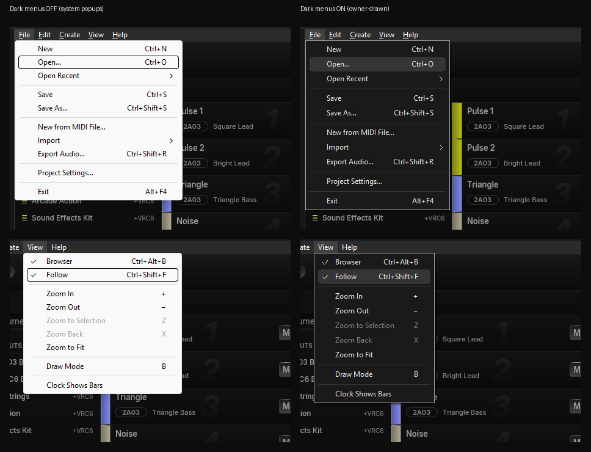

# Dark dropdown menus (Windows)

*2026-11-25 · BATCH3.md §5 option (c) · setting **Settings ▸ Display ▸ Dark menus**, default **Off***

## What was built
- **Setting:** `Settings.dark_menus: bool` in `settings.json` (serde default `false`; a file
  without the field keeps it off, unknown fields are ignored as before). A toggle row
  ("Dark menus: On / Off") in the Display tab, shown only in builds that have the native
  Windows menu bar (`cfg!(all(windows, feature = "menus"))`).
- **Dark popups:** every dropdown of the menu bar (File, Edit, Create, View, Help and their
  submenus Open Recent and Import) is owner-drawn while the setting is on:
  - background `#1A1A1A`, text `#E6E6E6`, disabled text `#808080`;
  - hovered row: a neutral grey wash (`#353535`, about 12 % white; `#272727` on a disabled
    row) inset 4 px with 4 px corners. No accent colour anywhere (a unit test checks that
    every colour is a neutral grey);
  - separators: a 1 px `#323232` line;
  - check marks and submenu arrows drawn as strokes in the text colour; shortcut text
    right-aligned in a column;
  - font: the system menu font (`NONCLIENTMETRICSW.lfMenuFont`) at the window's DPI;
  - all distances in 96-DPI pixels on the 4 px grid (row 24, separator 8, check gutter 32,
    shortcut gap 32, arrow column 24), scaled by `GetDpiForWindow` (per-monitor DPI).
- **Letter keys** in an open dark menu still work (`WM_MENUCHAR`): a letter unique to one
  row runs it, a shared one moves the highlight to the next match (checked in the app:
  Alt+F, S highlights Save; Alt+F, P opens Project Settings).
- **The menu bar** is unchanged: muda's own `MenuTheme::Dark` (see "Undocumented" below).

Code: `crates/ui/src/menus_dark.rs` (Win32 part, `#[cfg(all(windows, feature = "menus"))]`),
`crates/ui/src/menus.rs` (`dark_layout`: the platform-free layout, colours and key matching;
`NativeMenus::set_dark`; the hook is installed in `attach_hwnd`).

## How it works
1. `attach_hwnd` installs a window subclass on the main window (`SetWindowSubclass`), after
   muda's, so it sees menu messages first and passes everything else on (`DefSubclassProc`).
2. `WM_INITMENUPOPUP` (sent for each popup just before it shows; the window menu is skipped):
   - **on:** each item gets `MFT_OWNERDRAW` (`SetMenuItemInfoW`, `MIIM_FTYPE | MIIM_DATA`)
     and a tagged `dwItemData` key that maps to (menu, position); the popup gets a dark
     background brush (`SetMenuInfo`, `MIM_BACKGROUND`);
   - **off:** items we flagged are turned back into system items and the brush is cleared.
3. `WM_MEASUREITEM` / `WM_DRAWITEM` (`ODT_MENU`, only for items carrying our tag) measure and
   draw the row. Nothing about an item is cached: each measure and draw re-reads the text
   (`"Label\tShortcut"`, as muda stores it), check mark, enabled state and submenu with
   `GetMenuItemInfoW`. muda's `update()` (`set_enabled`, `set_checked`, `set_text`) changes
   only the state or string, never the type, so it shows at once; items muda adds later
   (Open Recent is rebuilt when the list changes) are flagged the next time that popup opens.
4. The system draws its own (dark grey) submenu arrow after `WM_DRAWITEM`, in the same DC, just
   right of the item rectangle; `ExcludeClipRect` over our arrow column and the space past it
   keeps our light arrow.

## Live or restart
**Live.** Changing the setting takes effect the next time a dropdown opens (each popup is
re-flagged as it opens); no restart, no menu rebuild. Checked in the release build: start
dark, turn it off in Settings, reopen File: system light menu; turn it on again: dark.

One Windows quirk handled on the way: clearing `MFT_OWNERDRAW` in place (even with the string
set again in the same call) left the rows blank and at our row height on Windows 11 build
26200. Turning an item back into a system item therefore removes it and inserts it again at
the same position with the same id, submenu, state and text (`RemoveMenu` keeps the submenu
alive; muda addresses its items by id, so it doesn't notice). Commands kept working after
the round trip (Edit ▸ Settings, then File ▸ Project Settings by its letter key); check
marks and enabling after a round trip were not separately captured.

## APIs used
All documented Win32 (user32, gdi32, comctl32), through `windows-sys 0.61` (already in the
tree via muda and winit; now a direct, optional dependency of `crates/ui` under
`[target.'cfg(windows)'.dependencies]`, enabled by the `menus` feature, features
`Win32_Foundation`, `Win32_Graphics_Gdi`, `Win32_UI_Controls`, `Win32_UI_HiDpi`,
`Win32_UI_Shell`, `Win32_UI_WindowsAndMessaging`).

| Purpose | Calls / messages |
|---|---|
| Hook | `SetWindowSubclass`, `DefSubclassProc` |
| Popup lifecycle | `WM_INITMENUPOPUP`, `WM_MEASUREITEM`, `WM_DRAWITEM`, `WM_MENUCHAR` (`MNC_EXECUTE`, `MNC_SELECT`) |
| Items | `GetMenuItemCount`, `GetMenuItemInfoW`, `SetMenuItemInfoW` (`MFT_OWNERDRAW`), `RemoveMenu`, `InsertMenuItemW`, `SetMenuInfo` (`MIM_BACKGROUND`) |
| DPI and font | `GetDpiForWindow`, `SystemParametersInfoForDpi(SPI_GETNONCLIENTMETRICS)` (fallback `SystemParametersInfoW`), `GetSystemMetricsForDpi(SM_CXMENUCHECK)`, `CreateFontIndirectW` |
| Drawing | `GetDC`/`ReleaseDC`, `FillRect`, `RoundRect`, `CreatePen`, `Polyline`, `DrawTextW`, `GetTextExtentPoint32W`, `GetTextMetricsW`, `SetTextColor`, `SetBkMode`, `SelectObject`, `GetStockObject(NULL_PEN)`, `ExcludeClipRect`, `CreateSolidBrush`, `DeleteObject` |

**Undocumented calls added by this work: none.**

**Undocumented, already present (not added here):** muda's dark menu *bar*
(`MenuTheme::Dark`, Batch 2) handles the undocumented `WM_UAHDRAWMENU` /
`WM_UAHDRAWMENUITEM` messages. It is purely cosmetic and falls back safely (if the messages
never arrive, the bar is drawn light by the system). Left as it was, independent of this
setting; switching the bar to `MenuTheme::Light` is a one-line change in
`NativeMenus::attach_hwnd` if the owner wants no undocumented messages at all.

## Limitations
- **Popup border:** the 1 px frame around each popup is drawn by the system and stays light
  grey (visible in the screenshot). No documented API recolours it.
- **Popup shadow and corners** stay the system's.
- **Hover is a wash, not a focus ring:** the light menus show a keyboard focus outline; the
  dark ones show the grey wash for both mouse and keyboard.
- **Only the menu bar's dropdowns.** muda context menus (not used by the app; its context
  menus are in-app) and the window's system menu (Alt+Space) are left alone.
- **An already open menu** doesn't change when the setting changes; the next one does.
- **Windows only.** macOS draws its own menus (the setting row is hidden there and in builds
  without the `menus` feature; the field is still saved).
- High contrast mode isn't special-cased: with the setting on, the dark colours are used.

## Tests
- `file::tests::dark_menus_default_off_and_round_trip`: default off, an older file keeps it
  off, `true` survives a save and load of `settings.json`.
- `menus::tests::dark_row_layout`: measuring at 96/120/144 DPI, the shortcut gap, the system
  check allowance, separators, a tall font, 4 px grid, text/shortcut split, stroke width.
- `menus::tests::dark_glyphs_stay_in_their_columns`: check mark in the gutter, arrow in its
  column, both inside the row, at 96–192 DPI; every colour neutral.
- `menus::tests::dark_menu_letters`: mnemonics (`&`, `&&`, first letter) and `WM_MENUCHAR`
  selection (unique runs, shared cycles).

## Proof
Release build, `CHIPDAW_DEV=1 CHIPDAW_AUDIO=0`, a throw-away `CHIPDAW_DATA_DIR` whose
`settings.json` set `dark_menus` false or true; Alt+F (and Alt+V), Down, screen capture.
The image above is `docs/screens/design-pass/menus-light-vs-dark.png` (light left, dark right;
File on top, View with checks and disabled rows below).
